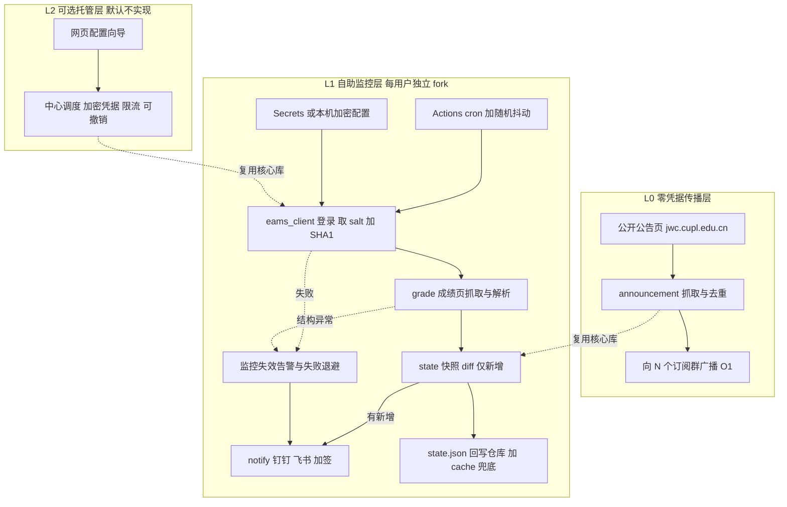

## 用户需求与补充

- 成绩按科目陆续发布，希望在任一**新科目成绩**出现时及时收到提醒，无需反复手动刷新教务系统。
- 提醒渠道：自建群机器人（钉钉/飞书），后续可方便扩展更多渠道。
- 运行方式：全天候无人值守定时检查，不依赖本地电脑常开。
- 触发规则：仅「新增科目成绩」提醒，避免重复打扰；首次运行不误报。
- 凭据：本人账号加密保存在本机、不进入代码仓库；云端以隔离配置注入。
- 补充约束：后续要做成**更多同学都能用**的产品，能够广泛传播、上手简单，不能只是单人脚本。
- 交付要求：先给出多个具体、可实行的方案及对比，再给出推荐落地路线。

## 产品概述

一个「教务成绩更新提醒」工具与服务：定时读取本人成绩，与上次快照比对，仅在出现新科目成绩时推送一条通知。通知以结构化消息卡片呈现，列出新增科目的课程名、分数、学分与学期，并附查询入口。产品形态同时覆盖「个人开箱即用」与「人人可自助订阅、可广泛传播」，并提供一个**无需任何账号**的公开通知层作为最低门槛入口。

## 核心功能

- 自动登录与成绩读取，逐科识别新增成绩；快照去重，仅新增触发。
- 群机器人消息推送，通知渠道可插拔替换。
- 全天候定时检查，以及登录失败、页面改版、连续异常时的「监控失效」告警。
- 多用户自助订阅：各人配置互相隔离，四步完成启用，无需服务器。
- 零凭据公开通知层：一次抓取、多方广播，负载与用户数解耦，便于大规模传播。
- 凭据保护、日志脱敏、快照可一键删除、合规说明与改密提示。
- 方案对比与选型结论、图文配置向导、故障排查与回退说明。

## Tech Stack Selection

基于已确认的探测事实与用户既有环境，全部落在空工作区 `c:/Users/49492/CodeBuddy/20261105122341/`（即未来的 GitHub 模板仓库根），不改动 `_devtools`。

- **语言与运行时**：Python 3.13（系统现有，无虚拟环境），依赖极简：`requests` + `beautifulsoup4`（沿用 `cupl_scraper.py` 已验证组合），标准库 `hashlib`/`hmac`/`json`/`logging`；`python-dotenv`、`keyring` 仅本机可选。不引入数据库、后端框架、浏览器运行时到生产依赖。
- **调度与托管**：GitHub Actions（`schedule` + `workflow_dispatch`），仓库本身兼作状态存储。
- **通知**：钉钉/飞书自定义机器人 Webhook，采用**加签 HMAC-SHA256** 或自定义关键词校验；抽象为 `Notifier` 协议便于扩展。
- **配置注入**：统一环境变量契约。本机从 `.env` / Windows 凭据管理器（DPAPI）读取，云端由 GitHub Secrets 注入，两者共用一份 `config.py`。
- **状态持久化**：`state/grades.json` 由工作流回写仓库（需 `contents: write`），`actions/cache` 仅作加速与兜底，不作唯一真相。
- **可复用资产**：`C:/Users/49492/CodeBuddy/_devtools/projects/cupl-daily-scraper/cupl_scraper.py` 的 `requests` 会话、`HEADERS`、`solve_challenge`（`dynamic_challenge` JS 挑战绕过）、`parse_all_dates`（含 `DDYYYY-MM` 特殊格式）与教务处板块配置，用于零凭据公告层；**仅参考复制必要逻辑到本项目，不修改 `_devtools`**。

## 一、可实行方案对比（用户要的「具体方案」）

| 方案 | 使用门槛 | 成本 | 时效 | 凭据风险 | 可扩展性 / 负载 | 传播友好度 |
| --- | --- | --- | --- | --- | --- | --- |
| **A 单人 Actions 自助监控**（用户已选，MVP） | 会填 3 个 Secret | 免费 | 5 分钟粒度 + 排队延迟 | 低（仅本人） | 单账号，O(1) | 低 |
| **B GitHub 模板仓库 fork 即用**（推荐主线） | fork → 填 3 个 Secret → 启用 → 一键测试 | 免费，零服务器 | 同 A | **低**：各人 Secret 不随 fork 继承，天然隔离 | 请求分散在各自 runner，无共享瓶颈 | **高**：一个链接即可扩散 |
| **C 零凭据公开公告监控 + 群广播**（推荐传播层） | 只需进群 / 加机器人，**无需账号** | 免费 | 分钟级，取决于公告发布 | **无**（不收集任何账号） | **O(1) 抓取、广播 N 个群**，负载与用户数解耦 | **最高** |
| **D 中心化托管 + 网页配置向导** | 填网页表单即可 | 需服务器 / 域名 / 运维 | 最优 | **最高**：服务端代管明文密码，风险不可消除 | N 个账号从同一批云 IP 高频登录，易触发风控 | 高但风险大 |
| **E 端侧形态**（桌面托盘 / 浏览器扩展） | 装一个客户端 | 免费 | 本地可控、最及时 | 极低（凭据不出本机） | 需设备常开，分发成本高 | 中 |


**选型结论**：以 **A（阶段 1 单人 MVP）→ B（阶段 2 模板仓库分发）** 为主线，叠加 **C（阶段 3 零凭据广播层）** 作为「广泛传播且简单易用」的答案；**D 默认不实现**，仅在文档中给出可选设计与风险清单；E 列为未来形态。

## 二、正面回答「广泛传播」的架构矛盾

用户希望「更多用户能用、广泛传播」，但直觉做法（一个服务端替所有人轮询）有两个硬伤：

1. **风控**：N 个账号从同一批云 IP 每 5 分钟登录一次 EAMS，极易触发 `/eams/captcha/image.action` 验证码、会话风控乃至封禁；单点故障影响全部用户。
2. **凭据**：服务端必须拿到明文密码才能登录（前端只做 SHA1 加盐，不构成保护），代管他人教务密码的安全与合规风险不可消除。

因此采用**分层架构**，让负载与凭据风险都不随用户数线性增长：

- **L0 零凭据层（C）**：只抓公开公告页（`jwc.cupl.edu.cn` 等）一次，向所有订阅群广播。抓取复杂度 **O(1)**，与用户数无关；无任何账号输入，是「扫码进群即可用」的传播入口。代价是只能提示「某批成绩发布」，不能精确到个人科目。
- **L1 自助分发层（B）**：每个用户 fork 模板仓库，凭据放在自己账号的 Secrets，请求分散在各自 runner 上；无共享服务器、无共享凭据、无跨用户数据。这是「精确到个人科目」的主力层。
- **L2 可选托管层（D）**：仅当确实需要「零 GitHub 账号」体验时再启用，必须配套：凭据加密存储（KMS/DPAPI）、单账号限流与错峰、用户一键撤销与删除、明确免责声明；且不得与 L1 共用出口 IP。

**降负载策略（各层通用）**：出分季启用、非出分季降频或停用（配置项控制）；cron 内随机 `sleep 0~240s` 抖动错峰；同仓库 `concurrency` 组防叠加运行；登录失败指数退避；单账号串行、绝不并发登录风暴。GitHub Actions 排队延迟决定了时效是**分钟级（约 5~15 分钟）而非实时**，需在文档中说明预期。

## 三、分阶段路线与验收成果

- **阶段 0 探测验证**：登录 EAMS 确认真实成绩 URL、请求参数、表格字段、登录成功判据、验证码触发条件；验证 GitHub Actions 境外出口能否访问 `jwxt`；产出《接口探测报告》。**验收**：能用脚本稳定拿到本人成绩列表。
- **阶段 1 单人 MVP**：核心库 + 通知适配器 + 主工作流，本机与 Actions 双跑。**验收**：新增一科成绩时收到且仅收到一条群消息；连续运行无重复推送；断网/登录失败时收到「监控失效」告警。
- **阶段 2 模板仓库可分发**：配置全外置、Secrets 清单、图文配置向导、上游同步说明。**验收**：一个未参与开发的同学按文档 10 分钟内独立跑通。
- **阶段 3 低门槛传播层**：L0 公开公告监控 + 群广播上线；D 方案作为可选设计文档。**验收**：新增一个订阅群无需改动代码，只需追加一个 Webhook 配置。

## 四、Implementation Approach（关键决策与执行细节）

**登录（已探测的确切契约，不可凭猜测改写）**：`GET /eams/homeExt.action` → 用正则从 `CryptoJS.SHA1('&lt;salt&gt;-' + form['password'].value)` 提取**本次页面**的随机 UUID salt（两次请求已观察到不同值，绝不硬编码）→ `hashlib.sha1((salt + '-' + 明文密码).encode()).hexdigest()` → **同一 Session/Cookie** 内 `POST /eams/localLogin.action`（`username`、`password`）。以「响应中不再含 `loginForm`」判定成功；失败不打印凭据。页面当前无验证码输入框，但存在 `refreshCaptcha` 与 `/eams/captcha/image.action`，需检测其出现并降级处理。

**成绩接口（尚未确认，禁止硬编码候选路径）**：`teach/grade/course/person!search.action` 与 `!historyCourseGrade.action` 未登录时均被导向登录页，真实路径、学期参数与表格结构必须在阶段 0 用浏览器登录后从菜单/网络请求确认，写入《接口探测报告》，再实现 `grade.py` 的解析。解析须做**结构健壮性检查**：表格缺失或列数异常时抛明确异常并触发告警，而不是静默返回空列表（避免成绩页改版后监控「假在线」）。

**快照去重（触发规则）**：以「课程标识 + 学期」为稳定键（建议存哈希或课程代码，不存完整成绩明细），`state/grades.json` 只保存用于比对的键集合与更新时间。**首次运行只建立基线、不推送**（否则一次性轰炸全部历史成绩）；后续仅返回新增键；未变化项不推送，符合用户「仅新增科目成绩」选择。单次 diff 为 O(n)，n 为成绩条目数（几十条），无 N+1 查询、无重复遍历。

**GitHub Actions 无状态持久化**：工作流 `checkout` → 读 `state/grades.json` → 运行 → 有新增时 `git commit/push` 回写（配置 `permissions: contents: write`）；`actions/cache` 作为加速与回写失败兜底（cache 不保证命中，不能当唯一真相）；`concurrency` 防止并发写冲突；`workflow_dispatch` 提供 `--dry-run` 一键测试。**额度提醒**：公共仓库 Actions 免费；若 fork 为 Private，5 分钟粒度约 8600 次/月会超出免费额度，需在向导中建议降频到 15 分钟或保持 Public 并把 state 内容脱敏。

**通知适配器**：`Notifier` 协议统一 `send_new_grades` / `send_alert`。钉钉：`timestamp + "\n" + secret` 作签名串、secret 作 key 做 HMAC-SHA256 → Base64 → URLEncode 拼到 URL；飞书：timestamp 与签名放入 JSON body；两者均可退化为「自定义关键词」。**GitHub Actions 出口 IP 动态，不可配置 IP 白名单**，必须用加签或关键词。消息只含课程名/分数/学分/学期/发现时间，不含学号与密码。

**配置与凭据**：`config.py` 按 `os.environ` → 本机 `keyring`/`.env` → 明确报错 的优先级加载，校验必填项。本机 `local_setup.ps1` 写入 Windows 凭据管理器或生成本机 `.env`；`.gitignore` 忽略 `.env`、`state/*.json`、`__pycache__`、日志。**注意用户当前密码与学号相同且已在对话中明文出现，文档须显著提醒尽快改密**；代码与日志绝不打印明文密码、Cookie、成绩明细；仅查本人成绩；快照支持一键删除；附免责声明与遵守学校信息系统使用规定的说明。

**Implementation Notes（性能、日志、爆炸半径）**：单次运行仅 3~4 次 HTTP（登录页、登录、成绩页），瓶颈在 EAMS 侧风控、Actions 排队与会话过期重登，而非本地计算。日志用标准库 `logging`，只输出「新增 N 门科目」「错误类型」等脱敏摘要，避免每次运行刷屏；连续失败达阈值才发告警。工作区为空、属全新项目，无历史兼容负担；不引数据库/服务器（YAGNI），不改动 `_devtools`（用户明确规矩）；核心库与调度层解耦，使 L0/L1/L2 共享同一套 `grade/state/notify` 逻辑；浏览器自动化仅用于阶段 0 探测，若其 CLI 不可用则退回 `probe_interface.py` 用 requests 手工复现 salt+SHA1，不进入生产依赖。Windows PowerShell 5.1 下含中文的 `.ps1` 必须存为 UTF-8 with BOM；安装依赖走清华镜像。

**回退预案**：① Actions 境外 IP 不通 → 文档给出国内云函数或本机计划任务（低频）方案；② 出现验证码 → 降频 + 人工介入，不做自动打码；③ 成绩页结构变更 → 解析失败告警而非静默失效；④ Actions 排队延迟/跳过 → 明确分钟级时效预期，出分高峰可临时本机高频运行；⑤ salt 或登录态变化 → 每次登录重新取页面 salt，不缓存。

## 五、Architecture Design



数据流向：定时触发 → 注入配置 → 建立会话（取 salt、SHA1、登录）→ 抓成绩页 → 标准化解析 → 与快照 diff → 有新增则推送并回写状态 → 全程异常分类、脱敏日志、失败退避与告警。L0/L1/L2 共享 `src/grade.py`、`src/state.py`、`src/notify.py`，仅调度与配置来源不同。

## 六、Directory Structure（全部为 [NEW]，工作区当前为空）

```
c:/Users/49492/CodeBuddy/20261105122341/        # 未来的 GitHub 模板仓库根
├── .github/workflows/
│   ├── grade-check.yml            # [NEW] 主监控工作流：cron+随机抖动、concurrency、checkout、装依赖、运行、state 回写、workflow_dispatch 一键测试
│   ├── connectivity-check.yml     # [NEW] 阶段0 一次性：验证 Actions 境外出口能否 GET 到 jwxt 登录页并取到 salt
│   └── announcement-watch.yml     # [NEW] L0 零凭据公告监控与多群广播工作流
├── src/
│   ├── config.py                  # [NEW] 统一配置加载与校验：环境变量优先，本机 .env/keyring 兜底；定义 Settings，集中管理 Secrets 键名
│   ├── eams_client.py             # [NEW] EAMS 会话：GET 登录页正则取本次 salt、SHA1(salt+密码)、POST localLogin、登录态判定、失效重登、验证码检测
│   ├── grade.py                   # [NEW] 依据接口报告抓成绩页，解析为 CourseGrade（课程名/学分/分数/绩点/学期/稳定键），结构异常抛可告警错误
│   ├── state.py                   # [NEW] 快照读写与 diff：首次建立基线不推送、仅返回新增科目、原子写、支持一键清空
│   ├── notify.py                  # [NEW] Notifier 协议 + 钉钉/飞书实现（加签 HMAC-SHA256 或关键词）、消息卡片模板、告警通道、发送失败不抛出未捕获异常
│   └── monitor.py                 # [NEW] 编排入口：登录→抓取→diff→推送→回写→失败退避与告警；CLI 参数 --once/--dry-run/--test-notify
├── scripts/
│   ├── probe_interface.py         # [NEW] 阶段0 辅助：登录后打印成绩菜单链接、网络请求与表格结构，产出接口探测素材（不进生产依赖）
│   └── local_setup.ps1            # [NEW] 本机初始化：将学号密码写入 Windows 凭据管理器或生成本机 .env（UTF-8 with BOM）
├── docs/
│   ├── 方案对比.md                 # [NEW] A/B/C/D/E 对比表、分层架构、选型结论与「广泛传播」矛盾分析
│   ├── 接口探测报告.md              # [NEW] 阶段0 产出：真实成绩 URL、参数、字段映射、登录判据、验证码行为、Actions 连通性结论
│   ├── 配置向导.md                 # [NEW] 面向非技术同学图文四步：fork 模板 → 填 3 个 Secret → 启用 Actions → 一键测试 → 配置群机器人加签
│   ├── 合规与隐私.md                # [NEW] 凭据存放、日志脱敏、仅查本人、快照可删除、免责声明、改密提醒、学校规定遵守说明
│   └── 故障排查与回退.md           # [NEW] 境外 IP 不通、验证码、页面改版、排队延迟、额度超限的预案与时效预期
├── config/
│   ├── .env.example               # [NEW] 配置模板，仅占位符，不含任何真实凭据
│   └── state.example.json         # [NEW] 快照结构示例（仅比对键与时间戳）
├── state/
│   └── grades.json                # [NEW] 运行时成绩快照（脱敏比对键），由工作流回写，可一键删除
├── tests/
│   ├── test_eams_client.py        # [NEW] 用伪造登录页 HTML 测 salt 提取与 SHA1 结果、登录成功判定
│   ├── test_grade.py              # [NEW] 用样本成绩表格测字段解析、稳定键生成与结构异常
│   ├── test_state.py              # [NEW] 测首次不误报、仅新增触发、重复运行幂等
│   └── test_notify.py             # [NEW] 测加签算法、消息格式与发送失败处理
├── .gitignore                     # [NEW] 忽略 .env、state/*.json、__pycache__、日志与本地缓存
├── requirements.txt               # [NEW] 精简依赖：requests、beautifulsoup4；本机可选 python-dotenv、keyring
└── README.md                      # [NEW] 项目总览、方案摘要、四步快速开始、模板仓库与上游同步说明、改密提示
```

## 七、Key Code Structures（仅核心抽象契约）

```python
# src/grade.py 与 src/state.py —— 多模块依赖的数据契约
@dataclass(frozen=True)
class CourseGrade:
    key: str          # 稳定键：课程标识 + 学期（建议哈希），用于 diff，非完整成绩明细
    course_name: str
    credit: str
    score: str
    gpa: str
    term: str

def parse_grades(html: str) -> list[CourseGrade]: ...          # 结构异常抛 GradeParseError
def diff(snapshot: dict, current: list[CourseGrade]) -> list[CourseGrade]: ...  # 首次基线返回空，仅新增
```

```python
# src/notify.py —— 可插拔通知适配器契约（多用户扩展点）
class Notifier(Protocol):
    def send_new_grades(self, grades: list[CourseGrade]) -> None: ...
    def send_alert(self, reason: str) -> None: ...

def build_notifier(channel: str, webhook_url: str, secret: str) -> Notifier: ...  # 钉钉/飞书加签或关键词
```

## Agent Extensions

### Skill

- **agent-browser**
- Purpose：在阶段 0 以真实浏览器打开 `http://jwxt.cupl.edu.cn/eams/homeExt.action`，填写登录表单（由页面 JS 自动完成 salt 加 SHA1，规避手工复现风险），登录后遍历「我的成绩」菜单、提取成绩表格与网络请求，并观察是否触发验证码；同时在阶段 1 用于端到端目视验证消息卡片效果。
- Expected outcome：产出《接口探测报告.md》，包含确认可用的成绩 URL、请求参数、表格字段映射、登录成功判据、验证码触发条件与页面结构样本，使 `grade.py` 有准确契约可依；若 CLI 不可用则退回 `scripts/probe_interface.py` 手工复现，不影响主流程。